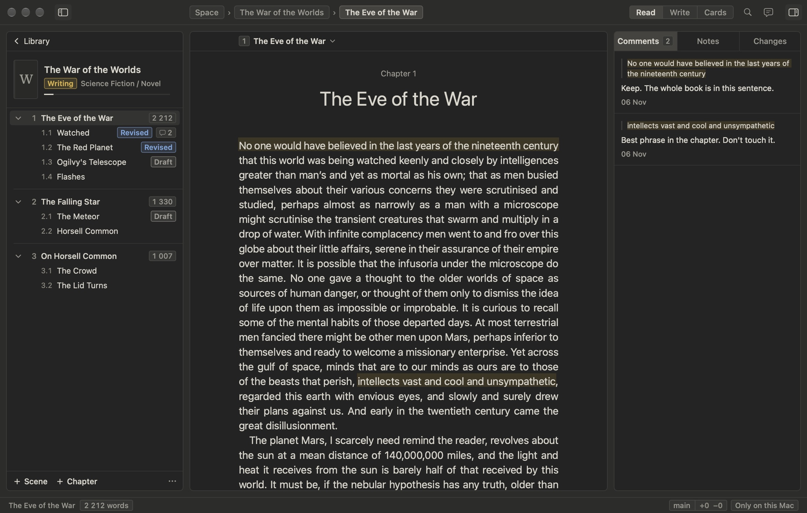

A lightweight writing app for fiction, essays, screenplays and more, saved as .md files and tracked with Git. Early beta.

**Download:** [the latest release](https://github.com/spec-proj/longhand/releases/latest)  
**Screenshots:** [spec-proj.github.io/longhand](https://spec-proj.github.io/longhand/)

## Features

- **Stories, chapters and scenes.** A 'story' is a folder of documents: chapters broken up into scenes, chapters or scenes alone, or a single document. **Screenplays are also supported, using [Fountain](https://fountain.io/).**
- **Git for writers.** Longhand is built to use Git and GitHub for tracking changes, versioning, and backing up your work, whether you do so locally or online.
- **Simple, macOS-forward design**, mostly keyboard-operable, with a VS Code-style command palette. Hide or show any UI element, or clear everything to focus on writing.
- **Typewriter scrolling, sentence/paragraph focus, word count targets** as well as comments and notes per scene, per chapter, and even per book. View your book or chapter in card view, rearrange your story, and switch back to read it as prose. 
- **A beautiful library,** with folders, author profiles and (optional) cover images. You can store multiple author profiles and set pen names. Save your work in standard manuscript formats or export as .pdf or .epub.
- **Future-proof** - your files are written in Markdown, stored as .md files and organised by the app with .json files, so you don't need Longhand to view them.
- Other features:
  - Create notebooks and collect poetry, lyrics, essays and short stories, with customisable file structures for each format.
  - Simple, distinct placeholder covers.
  - Many UI themes.

_Longhand isn't notarised, so macOS asks before opening it the first time. Open it once, then choose System Settings › Privacy & Security › Open Anyway._

Contribute: [Building Longhand](CONTRIBUTING.md).

## Credits

- Themes: `third_party/THEMES.md`.  
- Photographs: [NASA](https://www.flickr.com/photos/nasacommons)  
- Text: H. G. Wells, Edgar Rice Burroughs, Jules Verne and Albert Einstein, from Project Gutenberg.  
- Icon Assets: Book by Graphtend from <a href="https://thenounproject.com/browse/icons/term/book/" target="_blank" title="Book Icons">Noun Project</a> (CC BY 3.0)  
- GitHub and the Invertocat logo are trademarks of GitHub, Inc.

This is a vibe-coded project. I am not a developer, I just have a Claude licence from work and refuse to pay for Ulysses or Scrivener. I wanted something that blended the two and decided to just go for it. None of the text on this page is AI-generated! If the code sucks, please let me know, or make a pull request.

## Licence

MIT. See [LICENSE](LICENSE).
